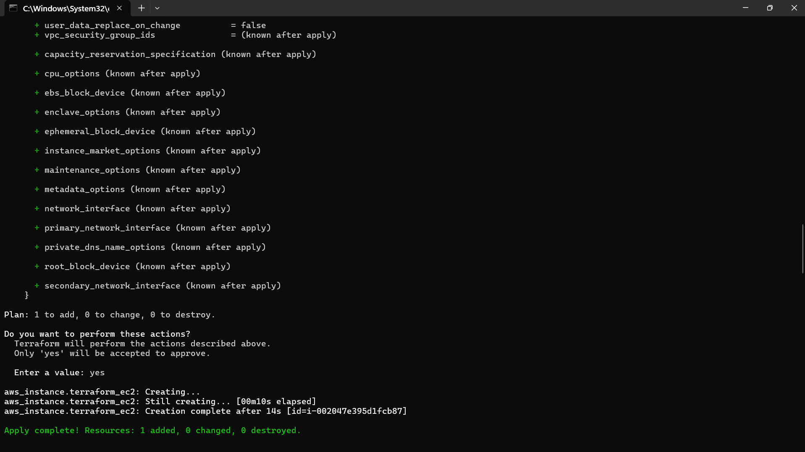
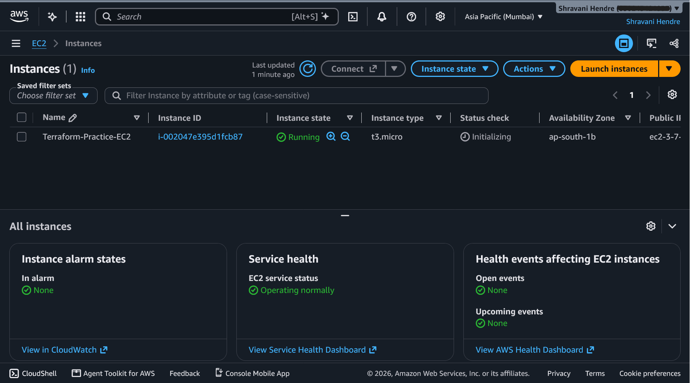
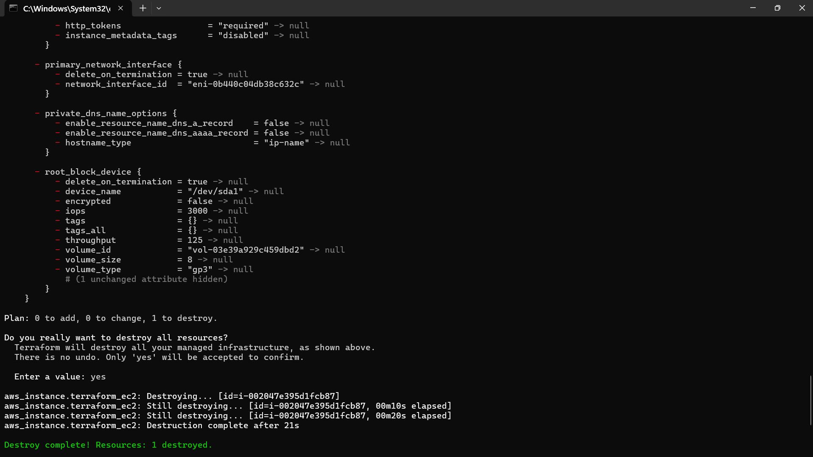
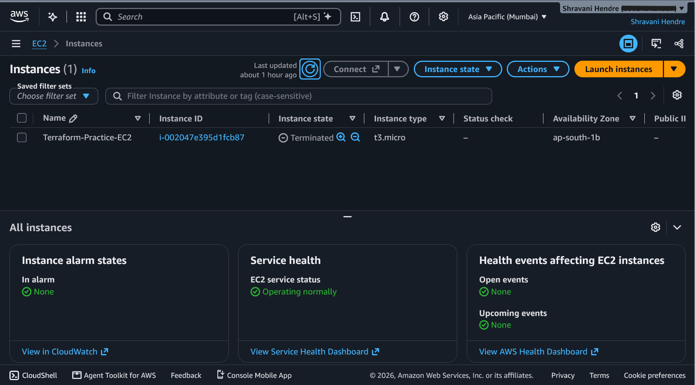

# 02 – Terraform and AWS Integration

## Goal
Learn the basic Terraform workflow by creating and deleting one EC2 instance on AWS, connecting Terraform to AWS through an IAM role.

## What I built
One `t3.micro` Ubuntu EC2 instance in `ap-south-1` (Mumbai), created and destroyed with Terraform. I ran this exercise directly on Windows.

## Tools used
- Terraform with the AWS provider
- AWS CLI, with a named profile that assumes an IAM role (`Terraform-Practice-Role`)
- A custom IAM policy attached to that role

## How the code works
```hcl
provider "aws" {
  region  = "ap-south-1"
  profile = "Terraform-Practice-Role"
}

resource "aws_instance" "terraform_ec2" {
  ami           = "ami-0fc5120b2d80d4749"
  instance_type = "t3.micro"
  tags = {
    Name = "Terraform-Practice-EC2"
  }
}
```
- `provider "aws"` tells Terraform to talk to AWS in Mumbai, using the CLI profile that assumes my IAM role.
- `resource "aws_instance" "terraform_ec2"` asks for one EC2 instance. `terraform_ec2` is the name Terraform uses internally.
- `ami` is the image to launch (Ubuntu 24.04). AMI IDs are region-specific, so this one only works in `ap-south-1`.
- `instance_type` sets the size (`t3.micro`).
- `tags` adds a `Name` label that shows in the Console.

## How to run it
```
terraform init       # download the AWS provider
terraform fmt        # fix formatting
terraform validate   # check the code
terraform plan       # preview: Plan: 1 to add
terraform apply      # create the instance
terraform destroy    # delete it
```

## Results





## IAM permissions: the part that took debugging
My role has a custom policy that allows describing resources, launching only `t3.micro` in `ap-south-1`, start/stop/terminate on instances, and tagging at launch.

**Problem:** testing with
```
aws ec2 run-instances --image-id <ami-id> --instance-type t3.micro --dry-run --region ap-south-1 --profile Terraform-Practice-Role
```
failed with `UnauthorizedOperation` on `network-interface/*`.

**Cause:** launching an instance touches several resources (instance, network interface, disk, image, subnet, security group), and AWS checks permission for each one. My `ec2:InstanceType = t3.micro` condition only fits the instance, so the other resources failed it.

**Fix:** I split `RunInstances` into two statements:
```json
{
  "Sid": "LaunchInstanceOnlyT3Micro",
  "Effect": "Allow",
  "Action": "ec2:RunInstances",
  "Resource": "arn:aws:ec2:ap-south-1:<ACCOUNT_ID>:instance/*",
  "Condition": {
    "StringEquals": {
      "ec2:InstanceType": "t3.micro"
    }
  }
},
{
  "Sid": "LaunchSupportingResources",
  "Effect": "Allow",
  "Action": "ec2:RunInstances",
  "Resource": [
    "arn:aws:ec2:ap-south-1::image/*",
    "arn:aws:ec2:ap-south-1:<ACCOUNT_ID>:network-interface/*",
    "arn:aws:ec2:ap-south-1:<ACCOUNT_ID>:volume/*",
    "arn:aws:ec2:ap-south-1:<ACCOUNT_ID>:subnet/*",
    "arn:aws:ec2:ap-south-1:<ACCOUNT_ID>:security-group/*",
    "arn:aws:ec2:ap-south-1:<ACCOUNT_ID>:key-pair/*"
  ]
}
```
**Why `--dry-run` is useful:** it tests permissions without creating or paying for anything.

## Cost safety
I destroyed the instance right after checking it in the Console and confirmed the state showed `terminated`. A stopped instance still pays for its disk, so only `terraform destroy` fully stops charges.

## What I learned
- The Terraform workflow, and what each command does: `init`, `fmt`, `validate`, `plan`, `apply`, `destroy`.
- `plan` previews changes. `apply` creates them.
- Terraform tracks what it built in a state file.
- Region matters: the Console showed no instance because it was set to Virginia, not Mumbai.
- IAM conditions can apply to more than one resource, so a restriction on the instance can block the supporting resources.

## Limits and next steps
- The AMI ID and settings are hardcoded. Exercise 03 moves them into variables.
- No security group or SSH access yet.
- State is stored locally.
