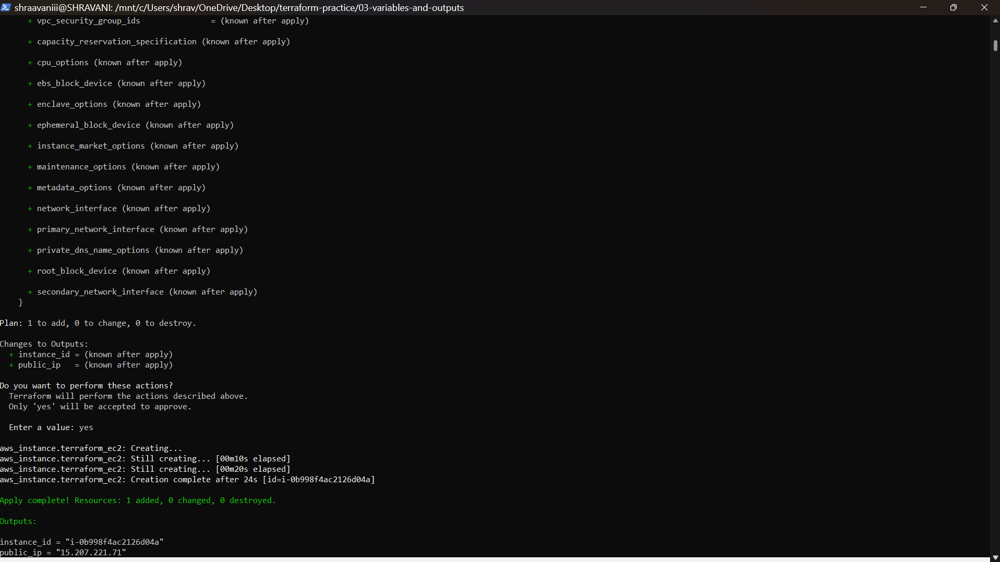
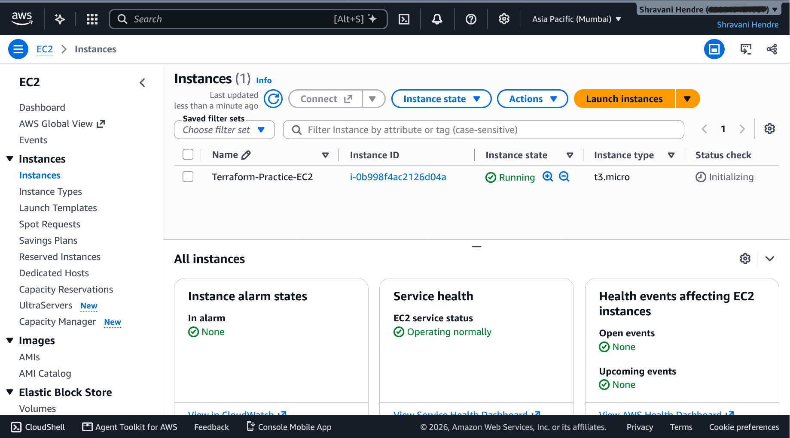
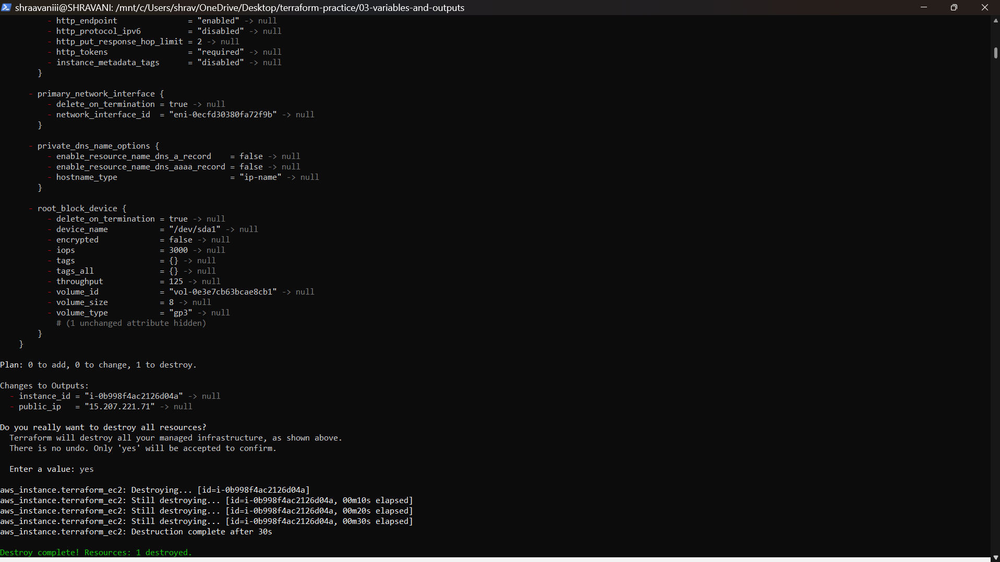
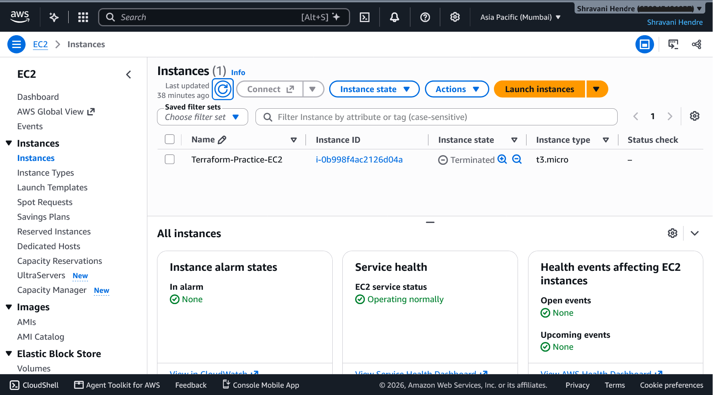

# 03 – Variables and Outputs

## Goal
Learn Terraform variables and outputs by building on exercise 02.

## What I built
The same `t3.micro` Ubuntu EC2 instance in `ap-south-1`, created and destroyed with Terraform. The settings now live in variables, and Terraform prints the instance ID and public IP after `apply`. I ran this exercise inside WSL2 Ubuntu (see "Problem I faced").

## Tools used
- Terraform and AWS CLI v2, installed inside WSL2 Ubuntu
- The same IAM role profile and custom policy as exercise 02

## Files and how they work
**`variables.tf`** – the settings:
```hcl
variable "region" {
  description = "AWS region"
  type        = string
  default     = "ap-south-1"
}

variable "instance_type" {
  description = "EC2 instance type"
  type        = string
  default     = "t3.micro"
}
```
Each variable has a type, a description and a default value.

**`main.tf`** – what to build, reading the settings with `var.<name>`:
```hcl
provider "aws" {
  region  = var.region
  profile = "Terraform-Practice-Role"
}

resource "aws_instance" "terraform_ec2" {
  ami           = "ami-0fc5120b2d80d4749"
  instance_type = var.instance_type
  tags = {
    Name = "Terraform-Practice-EC2"
  }
}
```
**`outputs.tf`** – what to print after `apply`:
```hcl
output "instance_id" {
  description = "ID of the EC2 instance"
  value       = aws_instance.terraform_ec2.id
}

output "public_ip" {
  description = "Public IP of the EC2 instance"
  value       = aws_instance.terraform_ec2.public_ip
}
```
Terraform reads all `.tf` files in the folder together, so the file names only keep things tidy.

## How to run it
```
terraform init
terraform fmt
terraform validate
terraform plan        # Plan: 1 to add, plus "Changes to Outputs"
terraform apply
terraform output      # prints the instance ID and public IP
terraform destroy
terraform state list  # empty after destroy
```
After `apply`, the end of the output looks like this (values will differ):
```
Outputs:

instance_id = "i-xxxxxxxxxxxxxxxxx"
public_ip = "x.x.x.x"
```

## Results





## Problem I faced
Windows blocked `terraform.exe` ("publisher can't be verified"), and Smart App Control was On. I did not turn the setting off. I did this instead:
1. Installed Ubuntu with `wsl --install -d Ubuntu`.
2. Installed Terraform and AWS CLI v2 inside Ubuntu.
3. Copied my AWS profile into Ubuntu's `~/.aws` and checked it with `aws sts get-caller-identity --profile Terraform-Practice-Role`.
4. Ran Terraform from Ubuntu, using the same project folder on the Windows drive.

I also once started the AWS CLI unzip from `C:\Windows\System32` by mistake. I cleaned up the two items it created and moved to my home folder.

## What I learned
- Variables keep settings in one place instead of hardcoding them in `main.tf`.
- Outputs print useful values after `apply`.
- Running `apply` again without changing the code makes no changes.
- Variables don't know about my IAM policy. My policy only allows `t3.micro` in `ap-south-1`, so other values would still be refused.
- WSL2 runs real Linux tools on Windows, which let me keep Windows security settings on.

## Limits and next steps
- The AMI ID is still hardcoded and only valid in `ap-south-1`.
- No security group or SSH access yet. That is the next exercise.
- State is stored locally.
