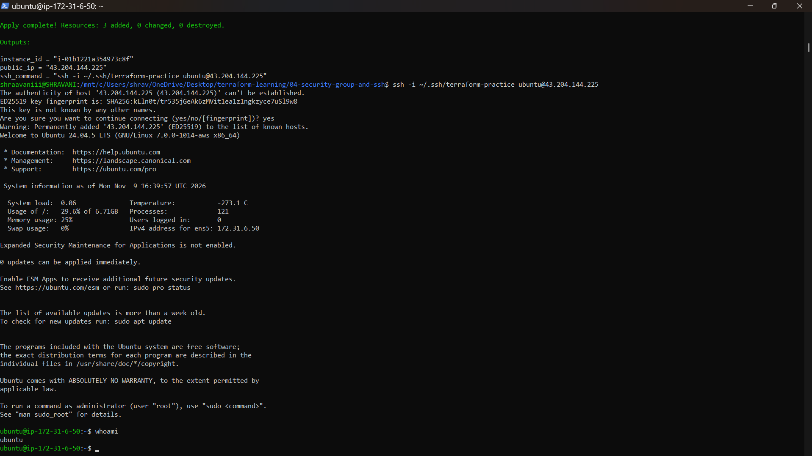
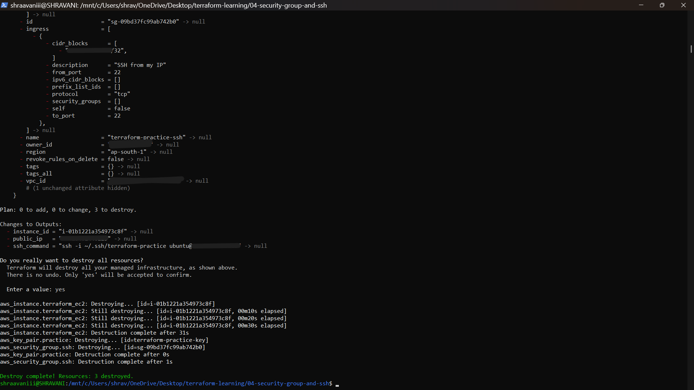

# 04 – Security Group and SSH

## Goal
Create an EC2 instance that I can log in to over SSH, with SSH allowed only from my own IP.

## What I built
- A key pair (the public key is uploaded to AWS; the private key stays on my laptop)
- A security group that allows SSH (port 22) only from my IP address
- The same `t3.micro` Ubuntu instance as before, using that key and security group
- An `ssh_command` output with the ready-made login command

I ran this in WSL2 Ubuntu, then logged in and destroyed everything.

## Files
- `variables.tf` – region, instance type, my IP (`my_ip_cidr`, no default) and the public key path
- `main.tf` – key pair, security group and instance
- `outputs.tf` – `instance_id`, `public_ip` and `ssh_command`
- `terraform.tfvars.example` – template for my own `terraform.tfvars`, which is not committed

## How it works
```hcl
resource "aws_security_group" "ssh" {
  name        = "terraform-practice-ssh"
  description = "Allow SSH from my IP only"

  ingress {
    description = "SSH from my IP"
    from_port   = 22
    to_port     = 22
    protocol    = "tcp"
    cidr_blocks = [var.my_ip_cidr]
  }

  egress {
    from_port   = 0
    to_port     = 0
    protocol    = "-1"
    cidr_blocks = ["0.0.0.0/0"]
  }
}
```
- `ingress` is who may connect in. Only my IP, with `/32` meaning exactly one address.
- `egress` is what the instance may reach. I allowed everything outbound, which is AWS's default.
- The instance uses `key_name` and `vpc_security_group_ids` to point at the key pair and the group, so Terraform creates them first.

## How to run it
```
ssh-keygen -t ed25519 -f ~/.ssh/terraform-practice
curl -4 -sS https://checkip.amazonaws.com        # find my IP
cp terraform.tfvars.example terraform.tfvars     # then put my IP in it
terraform init
terraform plan                                   # Plan: 3 to add
terraform apply
terraform output -raw ssh_command                # copy, paste, press Enter
terraform destroy
```

## Security choices
- SSH is open only to my IP, never `0.0.0.0/0`.
- `terraform.tfvars` (my IP), the state file and the private key are never committed.
- The private key stays in `~/.ssh` inside Ubuntu.

## IAM permissions I added
My role needed new permissions for security groups and key pairs. I added an inline policy limited to Mumbai:
```json
{
  "Version": "2012-10-17",
  "Statement": [
    {
      "Sid": "SecurityGroupAndKeyPair",
      "Effect": "Allow",
      "Action": [
        "ec2:CreateSecurityGroup",
        "ec2:DeleteSecurityGroup",
        "ec2:AuthorizeSecurityGroupIngress",
        "ec2:AuthorizeSecurityGroupEgress",
        "ec2:RevokeSecurityGroupIngress",
        "ec2:RevokeSecurityGroupEgress",
        "ec2:ImportKeyPair",
        "ec2:DeleteKeyPair"
      ],
      "Resource": [
        "arn:aws:ec2:ap-south-1:<ACCOUNT_ID>:security-group/*",
        "arn:aws:ec2:ap-south-1:<ACCOUNT_ID>:security-group-rule/*",
        "arn:aws:ec2:ap-south-1:<ACCOUNT_ID>:vpc/*",
        "arn:aws:ec2:ap-south-1:<ACCOUNT_ID>:key-pair/*"
      ]
    }
  ]
}
```
I tested the permissions for free first with `aws ec2 create-security-group --dry-run`.

## Results





## Cost safety
I destroyed everything right after logging in and confirmed the instance showed `terminated`.

## What I learned
- A security group is a firewall, and the source IP decides who can connect.
- A key pair has two halves: AWS holds the public key, and I keep the private key.
- My home IP can change, and then the SSH rule needs updating.
- Terraform works out the order (key pair and security group before the instance) from the references in the code.
- New resource types need new IAM permissions.

## Limits
- The AMI ID is hardcoded.
- It uses the default VPC.
- State is stored locally.

## Next steps
Remote state in S3.